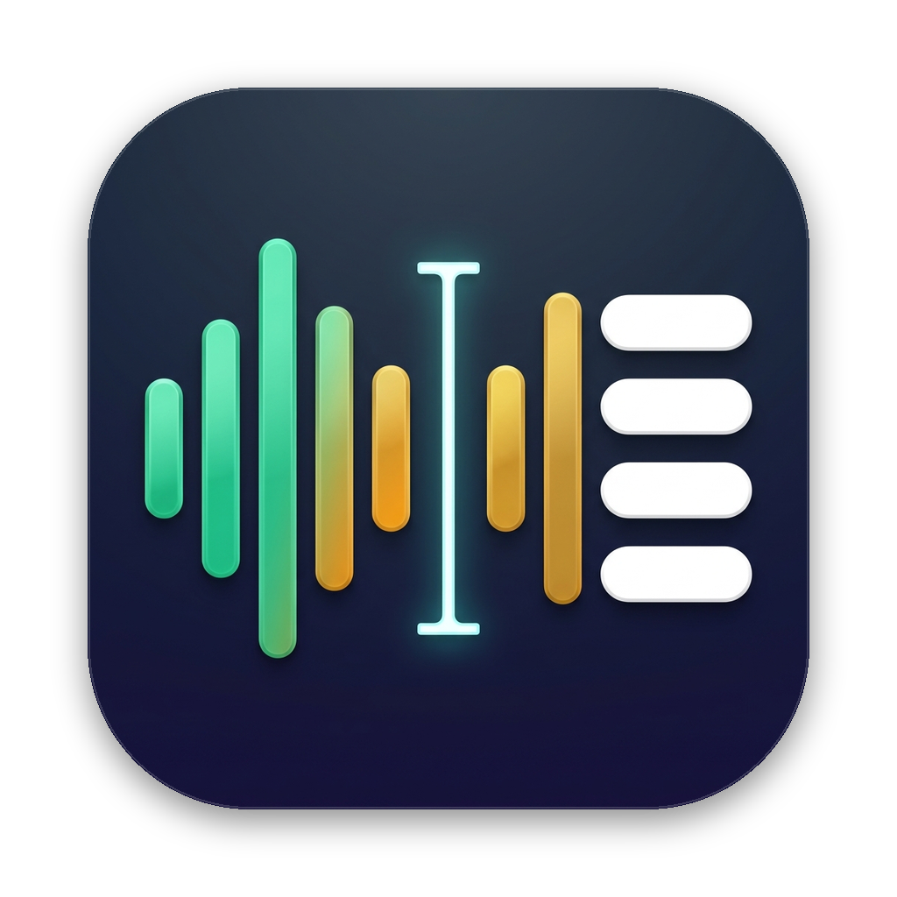
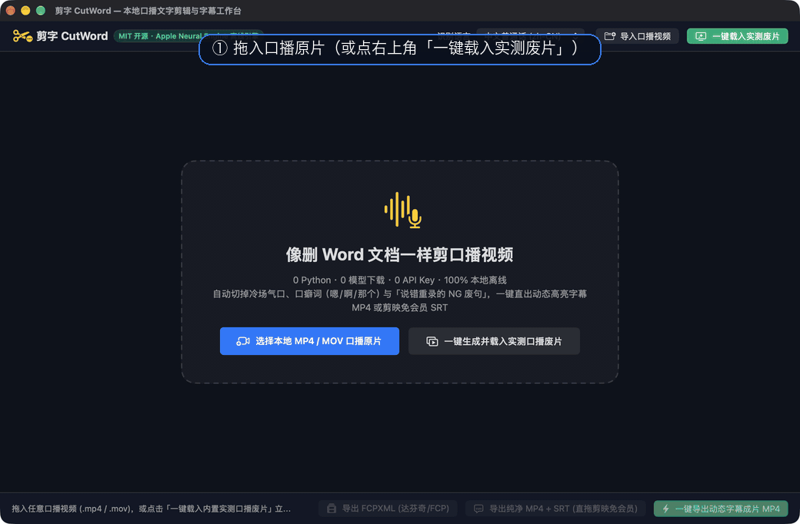
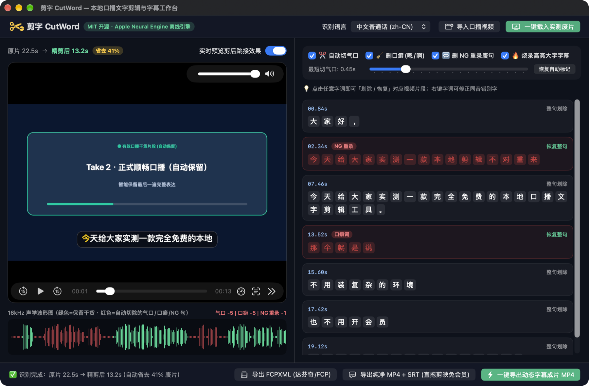

<div align="center">



# CutWord (剪字)

**Edit talking-head videos like a Word document — natively on Apple Silicon.**  
Pure Swift 6 · **2.2 MB** `.dmg` · Zero Python · Zero 2GB Whisper Downloads · Zero API Keys · 100% Offline

[](https://github.com/wang-builds/cutword/releases/latest)
[](https://github.com/wang-builds/cutword/releases/latest)
[](Package.swift)
[](LICENSE)

[**简体中文**](README.md) · [**English**](README.en.md) · [**Download `.dmg` (2.2 MB)**](https://github.com/wang-builds/cutword/releases/latest/download/CutWord-1.0.0-macos-arm64.dmg)

</div>

---

<div align="center">
  
</div>

## Why CutWord?

- **No Cloud Subscriptions**: Descript charges $16–$24/mo and uploads gigabytes of raw footage to the cloud.
- **No Paywalled Auto-Captions**: Mainstream consumer editors increasingly lock silence-cutting, filler removal, and SRT export behind VIP tiers.
- **No 3 GB Python Environments**: No Conda, no PyTorch, no multi-gigabyte Whisper weight downloads. `CutWord` runs directly on macOS's built-in Apple Neural Engine (`SpeechAnalyzer` + `SpeechTranscriber` + `AVFoundation` + `VideoToolbox`) in a **2.2 MB** native bundle.

<div align="center">
  
</div>

## Features

- **16kHz Acoustic Silence Trimming**: Automatically removes dead air (`≥ 0.45s`) while preserving `120ms` natural breath padding and applying `8ms` audio cross-fades at every splice to eliminate clicks/pops.
- **NG Bad-Take & Filler Word Detection**: Automatically flags filler words (`uh`, `um`, `嗯`, `啊`, `那个`, `就是说`) and repeated aborted takes, keeping only your final clean delivery.
- **Click Words to Cut Video**: Click any token to toggle cut/keep with instant zero-render `AVMutableComposition` preview; right-click any token to fix homophone typos.
- **3 Export Workflows**:
  1. **Karaoke Subtitled MP4** (`CoreImage` dynamic word highlight + `VideoToolbox` hardware acceleration)
  2. **Clean MP4 + Calibrated `.srt`** (drag straight into CapCut, Premiere Pro, or DaVinci Resolve)
  3. **Lossless `FCPXML v1.10`** (native timeline + caption lane for Final Cut Pro & DaVinci Resolve)
- **Built-in CLI + AI Agent Skill**: Includes `cutword` CLI and [`skills/cutword/SKILL.md`](skills/cutword/SKILL.md) for Claude Code, Cursor, Codex, and Antigravity.

## Install

Requires an Apple Silicon Mac running **macOS 26 (Tahoe) or newer**.

```bash
# Option 1: Homebrew (installs CutWord.app + `cutword` CLI)
brew install --cask --no-quarantine wang-builds/tap/cutword

# Option 2: Build from source (zero external dependencies)
git clone https://github.com/wang-builds/cutword.git
cd cutword
./scripts/package_app.sh
```

If downloading the `.dmg` directly from [Releases](https://github.com/wang-builds/cutword/releases/latest), clear macOS Gatekeeper quarantine once before first launch:

```bash
xattr -cr /Applications/CutWord.app
```

## CLI Quickstart

```bash
# Auto-clean pauses, fillers & NG takes, and export subtitled MP4 + SRT + FCPXML
cutword auto input.mp4 --out clean.mp4 --srt clean.srt --fcpxml clean.fcpxml

# Generate a built-in spoken test video to try CutWord in 5 seconds
cutword demo --out sample_raw.mp4
```

## License

Released under the [MIT License](LICENSE).
