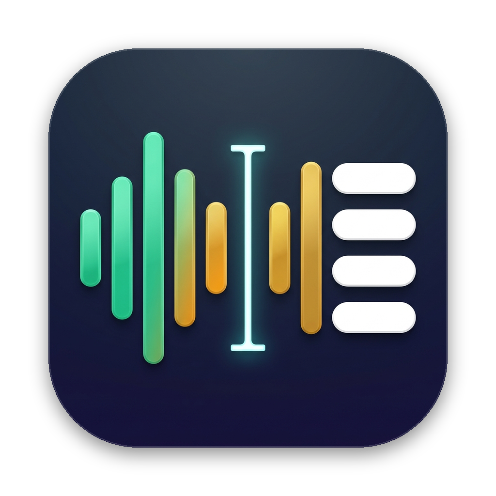
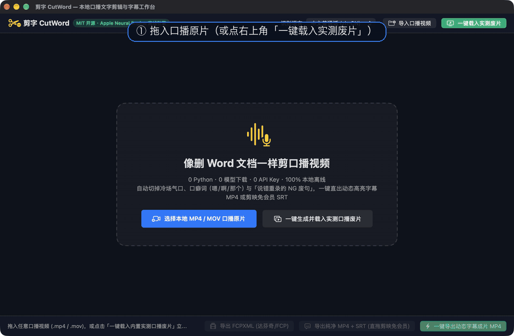
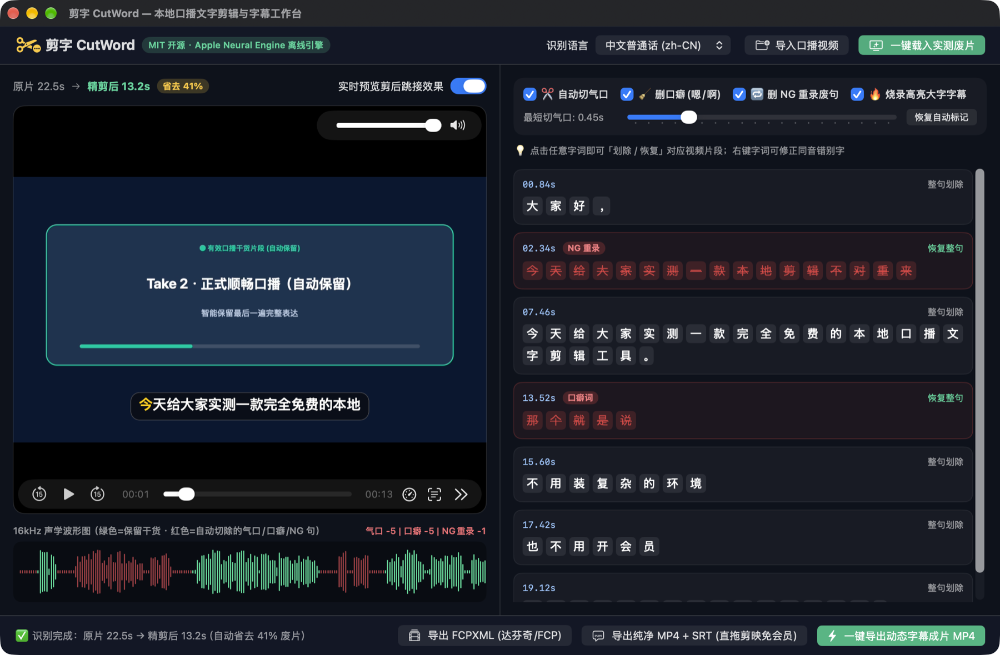

<div align="center">



# CutWord · 剪字

**像删 Word 文档一样剪口播视频**  
纯原生 Swift 6 打造 · 安装包仅 **2.2 MB** · 0 Python · 0 模型下载 · 0 API Key · 100% 本地离线

[](https://github.com/wang-builds/cutword/releases/latest)
[](https://github.com/wang-builds/cutword/releases/latest)
[](Package.swift)
[](#技术架构)
[](LICENSE)

[**简体中文**](README.md) · [**English**](README.en.md) · [**下载 macOS 安装包 (.dmg)**](https://github.com/wang-builds/cutword/releases/latest/download/CutWord-1.0.0-macos-arm64.dmg) · [**命令行与 AI Agent Skill**](#命令行与-ai-agent-skill)

</div>

---

<div align="center">
  
</div>

> **💡 科技博主 / 开发者 5 秒实测提示**：打开软件无需自备口播素材，直接点击右上角 **「一键载入实测废片」**，本机即刻生成一段含「冷场停顿 + 说错重录 NG 句 + 口癖词」的测试视频并完成自动精剪，开箱即可验证效果。

---

## 为什么要做 CutWord？

录一条 3 分钟的口播视频，真正头疼的从来不是调色，而是**剪掉十几个换气停顿、口癖「嗯/啊/那个」，以及一遍遍说错重来的 NG 废句**：

| 常见方案 | 真实卡点 |
| :--- | :--- |
| **商业剪辑软件** | 「识别字幕」「智能剪气口」「去水词」相继锁入付费会员，且新版草稿文件已加密无法外部脚本直改 |
| **Descript 等海外工具** | 订阅制（$16–$24/月），需上传云端转写，对中文同音字与中式「不对重来」口误识别水土不服 |
| **Python + Whisper 开源脚本** | 动辄配置 Conda / PyTorch / FFmpeg 环境，还要下载 **1.5 GB ~ 3 GB** 模型权重，换台电脑又报错 |
| **CutWord · 剪字（本项目）** | 直接调用 Apple Silicon 系统内置神经网络语音引擎与硬件编解码，**整个 App 仅 2.2 MB**，双击即用、断网可跑、永久免费开源 |

<div align="center">
  
</div>

---

## 核心特性

- **✂️ 毫秒级气口切除 + 自然呼吸留白 + 防爆音过渡**  
  基于 `16kHz PCM` 声学能量扫描，自动切除 `≥ 0.45s`（可滑块实时调节）的冷场静音；智能保留字词首尾 `120ms` 自然呼吸气口，并在每一处跳剪接缝自动施加 `8ms` 音频淡入淡出斜坡，彻底告别硬切「咔哒」爆音。
- **🔁 中文同音感知「NG 重录废句」自动识别**  
  针对口播高频出现的 *「今天给大家实测一款本地剪辑……不对重来……今天给大家实测一款完全免费的本地口播文字剪辑工具」*，内置中文常见同音字归一与前缀相似度比对，自动将前一遍废稿整句标红划除，精准保留最后一遍完整表达。
- **🧹 中英口癖水词一键标橙剔除**  
  自动识别独立口癖与犹豫词（`嗯`、`啊`、`呃`、`那个`、`就是说`、`怎么说呢`、`um`、`uh` 等），一秒收紧口播节奏。
- **📝 真正的「删字即剪片」+ 实时无损跳接预览**  
  - **左键点任意字词**：立即切换「划除 / 保留」对应时间轴视频片段，左侧 `AVMutableComposition` 播放器**零等待实时预览跳接效果**（无需先渲染导出）。  
  - **右键点任意字词**：秒改同音错别字，实时同步到烧录字幕与导出 `.srt`。
- **🚀 三路零门槛导出（完美兼容剪映 / Final Cut Pro / PR / 达芬奇）**  
  1. **一键直出动态高亮字幕成片 (`MP4`)**：`CoreImage` 渲染逐字卡拉 OK 金色高亮胶囊字幕 + `VideoToolbox` 硬件加速直出。  
  2. **导出纯净 MP4 + 校准 `.srt` 字幕（0 元平替会员字幕）**：将精剪后的无字幕 MP4 与重新校准好时间轴的 `.srt` 一起拖入**任意免费版剪映 / Premiere / 达芬奇**，0 成本直接套花字。  
  3. **导出无损 `FCPXML v1.10` 时间轴**：直接导入 Final Cut Pro 或 DaVinci Resolve，完整保留原素材画质、全部剪辑切点与独立字幕轨。

---

## 30 秒安装指南

> **系统要求**：Apple Silicon Mac（M1 / M2 / M3 / M4 / M5），系统版本 **macOS 26 (Tahoe) 或更高版本**（依赖系统原生离线 `SpeechAnalyzer` 引擎）。

### 方式一：Homebrew 一键安装（推荐）

自动安装桌面版 `CutWord.app` 与终端命令行 `cutword`，并自动跳过未公证开源应用的首次拦截弹窗：

```bash
brew install --cask --no-quarantine wang-builds/tap/cutword
```

### 方式二：直接下载 `.dmg` 安装包（2.2 MB）

1. 前往 [**Releases 页面下载最新版 `CutWord-1.0.0-macos-arm64.dmg`**](https://github.com/wang-builds/cutword/releases/latest/download/CutWord-1.0.0-macos-arm64.dmg)，拖入 `Applications` 文件夹。
2. 由于个人开源项目未购买每年 $99 的 Apple Developer ID 公证签名，首次打开若提示「无法验证开发者」，在终端执行一行命令即可放行：

```bash
xattr -cr /Applications/CutWord.app
```

### 方式三：从源码编译打包

零第三方依赖（`Package.swift` 仅调用系统原生框架），克隆后一行脚本即可生成 `.app` 与 `.dmg`：

```bash
git clone https://github.com/wang-builds/cutword.git
cd cutword
swift test
./scripts/package_app.sh
open dist/CutWord.app
```

---

## 命令行与 AI Agent Skill

`CutWord.app` 内置了完整的无头命令行工具 `cutword`（通过 Homebrew 安装后已自动加入 `PATH`），非常适合批量自动化剪辑或交给 AI 编程助手调用：

```bash
# 1. 一键全自动精剪口播视频（切气口 + 删口癖 + 删 NG 废句 + 烧录高亮字幕 + 导出 SRT 与 FCPXML）
cutword auto raw_talking.mp4 \
  --out clean_subtitled.mp4 \
  --srt clean.srt \
  --fcpxml clean.fcpxml

# 2. 仅导出纯净精剪无字幕 MP4 + 对齐好的 SRT（适合拖进剪映/PR 加自定义花字）
cutword auto raw_talking.mp4 --no-subtitles --out clean_pure.mp4 --srt clean.srt

# 3. 仅输出逐字时间戳与废片切点 JSON 报告（不渲染视频）
cutword analyze raw_talking.mp4 --json report.json

# 4. 在本地生成一段含口误与停顿的测试口播视频
cutword demo --out sample_raw.mp4
```

### 接入 Claude Code / Cursor / Codex / Antigravity

仓库内置标准 Agent Skill 文件 [`skills/cutword/SKILL.md`](skills/cutword/SKILL.md)，复制到你的 Agent 技能目录后，直接对 AI 说 **「帮我把桌面那条口播视频的气口和说错重录的废话剪掉，顺便出个字幕版」** 即可全自动完成：

```bash
mkdir -p ~/.claude/skills/cutword && cp skills/cutword/SKILL.md ~/.claude/skills/cutword/
```

---

## 技术架构

```text
CutWord (Pure Swift 6.2 · Zero External Dependencies)
├── CutWordCore/
│   ├── AudioWaveformAnalyzer.swift  # AVAssetReader 16kHz 单声道 PCM 能量包络与静音区间检测
│   ├── SpeechEngine.swift           # SpeechAnalyzer + SpeechTranscriber 本地离线逐字时间戳提取
│   ├── SmartCutDetector.swift       # 分句聚类、中英口癖识别、同音字归一 NG 重录检测、时间轴编译器
│   ├── Exporters.swift              # AVMutableComposition 无缝拼接 + 8ms 防爆音 AudioMix + CoreImage 字幕烧录 + SRT/FCPXML
│   └── CutWordPipeline.swift        # 端到端分析流水线 + 内置 TTS 实测样片生成器
├── CutWordCLI/                      # `cutword` 命令行批处理工具 (demo / analyze / auto)
└── CutWordApp/                      # 原生 SwiftUI 暗色非线性文字剪辑工作台
```

---

## 开源协议与自媒体分享说明

本项目采用 [**MIT License**](LICENSE) 永久开源免费。  
非常欢迎 **B 站 UP 主、抖音/小红书创作者、独立开发者周刊与技术社区** 实测、录屏分享或二次开发（附上本仓库链接 `https://github.com/wang-builds/cutword` 即可）。如果你遇到了特定方言或口误句式没被识别出来，欢迎直接提 Issue！
